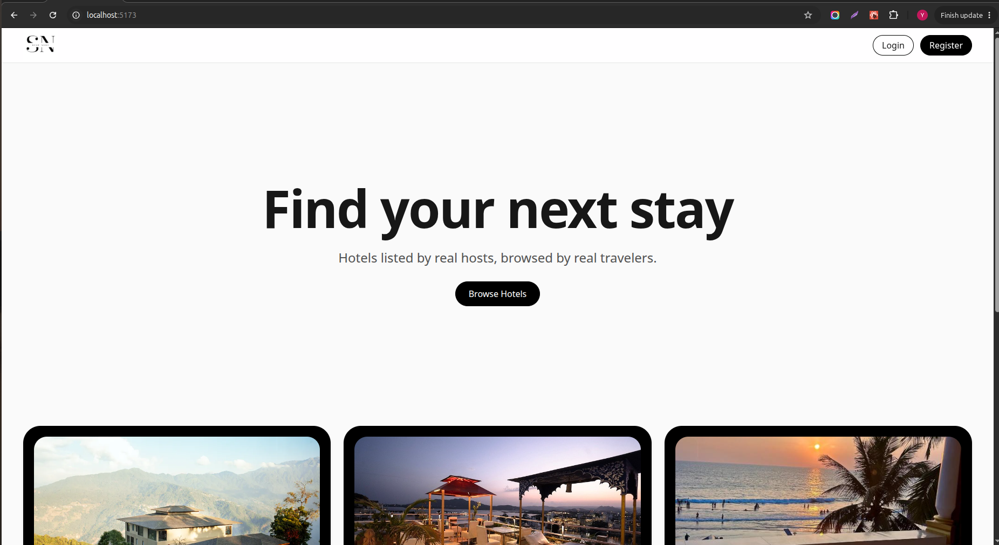
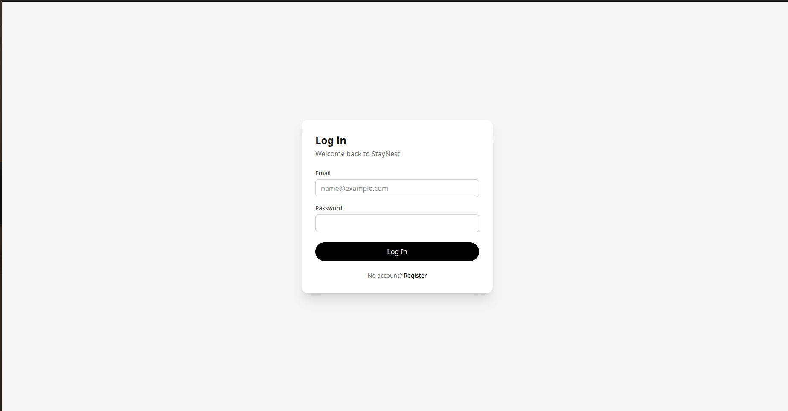
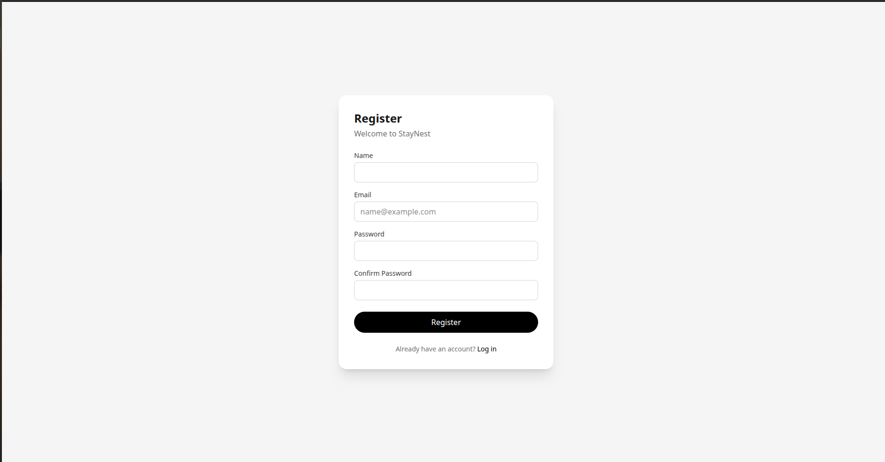
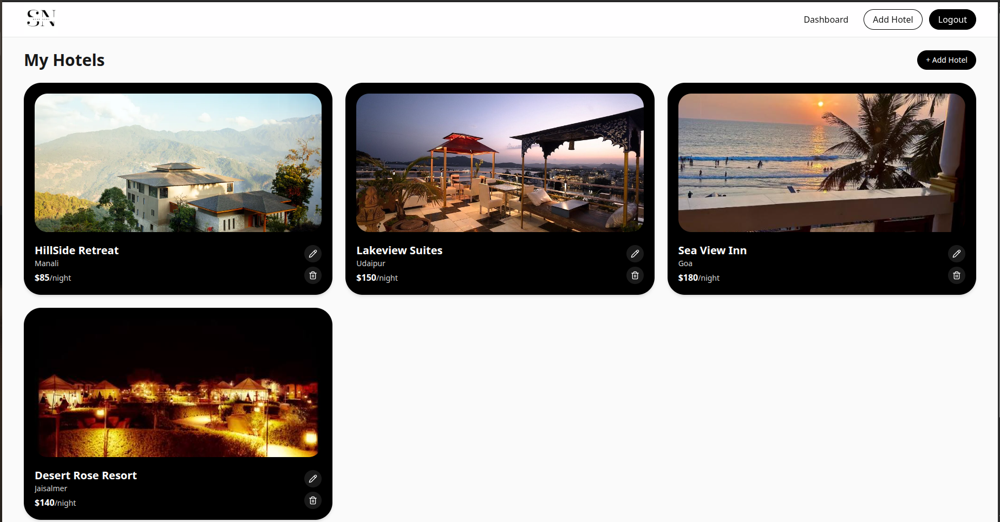
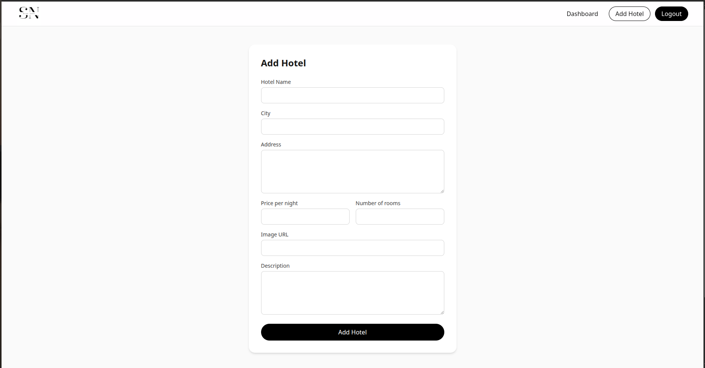
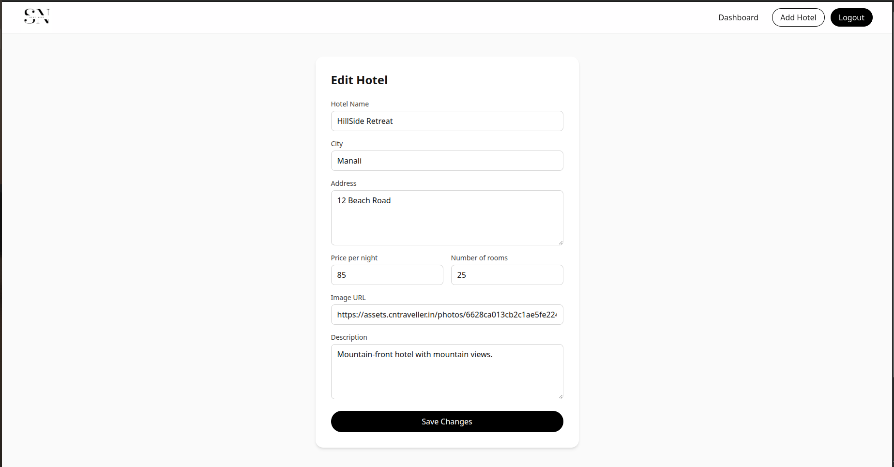

# StayNest

A hotel listing website built as a frontend assignment. Users can register, log in, browse hotels, and manage their own listings (add, edit, delete) from a dashboard. Each hotel can have several images, shown in a carousel on its card.

The repository has two parts:

- `hotel-listing-frontend/` — the React app (this README)
- `hotel-listing-backend/` — the provided Express API (see its own README)

## Tech Stack

- **React + Vite** — functional components and hooks
- **TypeScript**
- **Tailwind CSS** — all styling
- **React Query (TanStack Query)** — all API calls (`useQuery` for reads, `useMutation` for writes)
- **React Hook Form** — all forms, with validation and error messages
- **React Router** — routing, including route guards for private and public-only pages
- **lucide-react** — icons

## Features

- Register and log in with a JWT returned by the API, stored so the session survives a page refresh
- Landing page listing every hotel, with loading, error and empty states
- Dashboard showing only the logged-in user's own hotels
- Add and Edit hotel, sharing one form component and its validation
- Delete a hotel, with a confirmation dialog before the request is sent
- Private pages (`/dashboard` and its sub-routes) redirect to `/login` when logged out
- Responsive layout for mobile, tablet and desktop

## Getting Started

### Prerequisites

- Node.js 20 or newer

### Installation

```bash
git clone <repo-url>
cd staynest
```

### 1. Run the backend

```bash
cd hotel-listing-backend
npm install
cp .env.example .env
```

Open the new `.env` file and allow the frontend's origin (Vite runs on port 5173):

```
CORS_ORIGIN=http://localhost:5173
```

Then start the API:

```bash
npm run dev
```

The API runs at `http://localhost:4000`. Without the `CORS_ORIGIN` line, the browser blocks the frontend's requests.

### 2. Run the frontend

In a second terminal, from the repository root:

```bash
cd hotel-listing-frontend
npm install
```

Create a `.env` file in `hotel-listing-frontend/`:

```
VITE_API_BASE_URL=http://localhost:4000
```

Vite only exposes variables prefixed with `VITE_`, and the dev server needs a restart after changing this file.

```bash
npm run dev
```

The app runs at `http://localhost:5173`.

## Routes

| Path                  | Access     | Description                     |
| --------------------- | ---------- | ------------------------------- |
| `/`                   | Logged out | Landing page with all hotels    |
| `/login`              | Logged out | Login form                      |
| `/register`           | Logged out | Registration form               |
| `/dashboard`          | Logged in  | The logged-in user's own hotels |
| `/dashboard/add`      | Logged in  | Add a new hotel                 |
| `/dashboard/edit/:id` | Logged in  | Edit an existing hotel          |

Private routes redirect to `/login` if there is no logged-in user. Logged-in users who open `/`, `/login` or `/register` are redirected to the dashboard.

## Screenshots

Landing Page



Login Page


Register Page


Dashboard Page


Add Hotel Page


Edit Hotel Page

